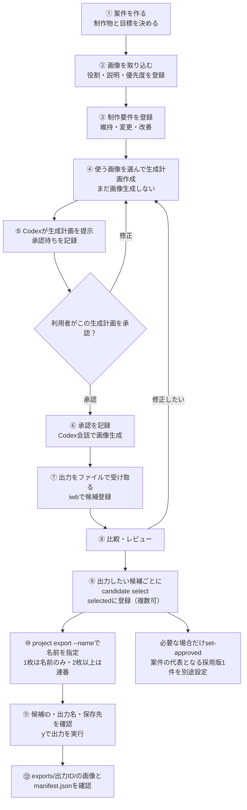
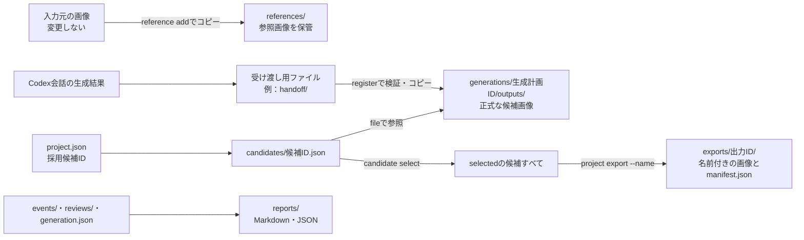

# はじめての操作マニュアル — 画像の取り込みから生成・選択・名前付け・出力まで

作成日：2026-10-16。更新日：2026-10-17（ver4.3）。対象：Windows / PowerShell、Python 3.12以上、Image Workbench 0.1.0。

仕様の基準は[仕様書 ver4.1（Codex会話環境版）](https://app.notion.com/p/3f4f252ab68381e8bc40dc251b3ca08c)、[ver4.2変更点仕様](https://app.notion.com/p/3fcf252ab68381abb8eed67a27a47e71)、[ver4.3変更点仕様](https://app.notion.com/p/3fcf252ab6838108acf0dc0b7fd1d8fa)。このマニュアルは、同仕様と `src/image_workbench/` の実装を照合して作成した操作案内です。実際の画像生成を含む一連の動作の合格報告ではありません。

## 1. このハーネスで何をするのか

複数の参照画像に「何の参考にするか」を付け、制作目標や要件と組み合わせて生成計画を作り、生成結果・評価・採用判断を記録します。

**操作窓口は2つです。** Codexの会話で相談・生成計画確認・承認・画像生成を行い、`iwb` コマンドで画像や記録をローカル保存します。`iwb generate plan` や `approve` だけを実行しても画像は生成されません。Web画面や専用GUIはありません。



### 最初に覚える5つの言葉

| 名前 | 意味 | IDを確認する操作 |
| --- | --- | --- |
| 案件 / Project | 1つの制作テーマをまとめる箱 | `iwb project list` |
| 参照 / Reference | 取り込んだ画像と、その使い方 | `iwb reference list $ProjectId` |
| 要件 / Requirement | 制作物が満たすべき条件 | `iwb requirement list $ProjectId` |
| 生成計画 / Generation | 1回分の固定された生成計画と、その後の実行記録 | `iwb generate list $ProjectId` |
| 候補 / Candidate | 検証して案件内へ保存した結果画像 | `iwb candidate list $ProjectId` |

「生成計画ID」はGenerationのID（Generation ID）です。新規画像生成と候補画像の編集の双方を「生成計画」と呼びます。IDは省略しないUUID v4です。「現在の案件」を暗黙には保持しません。コマンド名・JSONキーは従来どおりで、既存の案件記録・過去のレポートは書き換えません。

## 2. 初回の準備

### 2.1 起動場所とコマンドを確認する

PowerShellを開き、毎回このディレクトリから作業します。

```powershell
Set-Location -LiteralPath 'C:\Codex_Projects\ImageCreator'
python --version
iwb --help
iwb config show
```

Pythonは3.12以上が必要です。`iwb` が見つからない場合、インストール済みのPython環境で次を試してください。

```powershell
python -m image_workbench.cli --help
python -m image_workbench.cli config show
```

この方法で動く場合、以降のすべての例の `iwb` を `python -m image_workbench.cli` に置き換えられます。マニュアル作成時の環境では、この方法で起動を確認しました。

モジュールも見つからない未導入環境では、リポジトリ直下で次の初回セットアップを行います。既に使える環境では不要です。

```powershell
python -m venv .venv
.\.venv\Scripts\python.exe -m pip install -e .
.\.venv\Scripts\iwb.exe --help
```

この `pip` コマンドは **このリポジトリの `.venv` に本体と実行依存を導入する操作**です。以後は `iwb` の代わりに `.\.venv\Scripts\iwb.exe` でも実行できます。仮想環境を有効化する場合は `.\.venv\Scripts\Activate.ps1` を使います。有効化が制限されている環境でも、上の実行ファイルの直接指定を使えます。

### 2.2 保存先を確認する

現在の `config.toml` は次の設定です。

```toml
default_candidate_count = 4
max_candidate_count = 10
projects_dir = "projects"
```

既定の案件保存先は `C:\Codex_Projects\ImageCreator\projects`。相対パスの `projects` と `config.toml` は **CLIを起動するディレクトリを基準に解決**されます。別の場所で起動すると、違う案件一覧や保存先になるため注意してください。

希望枚数は1〜10、未指定なら現在の設定では4枚です。実際に出てくる枚数の保証ではありません。

### 2.3 画像と会話環境を用意する

- 入力画像はPNG、JPEG、WebP。ファイル名だけ形式を変更しても使えません。
- 画像のパスを用意します。スペースを含むパスは引用符で囲みます。
- 画像生成には、対応するCodex/ChatGPT会話環境が必要です。CLI単独では生成できません。
- APIキーの用意は不要です。生成前に、生成計画で選んだ画像を会話で実際に参照できることと、結果をローカルファイルとして受け取れることを確認します。
- 利用枠やクレジット残量をこのハーネスから照会・遮断することはできません。上限が示されたら停止します。追加クレジットを使わない場合は、事前にアカウント側の設定も確認してください。

### 2.4 一覧のIDを省略せず参照する（ver4.2）

`project list`、`reference list`、`requirement list`、`candidate list`、`generate list` は対話端末では実行時点の一覧をキャッシュに保存し、VS Codeへ表示を依頼してすぐに戻ります。件数、完全なID、名前・状態・説明等を項目ごとに表示するため、狭い端末の表組みでIDが省略されることはありません。

```powershell
iwb project list
iwb reference list $ProjectId
iwb requirement list $ProjectId
iwb candidate list $ProjectId --generation $GenerationId
iwb generate list $ProjectId
# 端末表示を選ぶ場合（5種類のlistで利用可能）
iwb project list --terminal
```

タブやVS Codeを閉じる操作は不要です。一覧を開いたままIDをコピーして、次のコマンドに使用できます。キャッシュは自動削除せず、再実行時も別IDで保存します。一覧には取得日時（UTC）を記録し、その後の案件更新には追随しません。編集・保存しても案件には反映しません。

非対話実行・パイプ・リダイレクト・0件ではエディタとキャッシュを作らず、全文を端末に出力します。VS Codeのcodeコマンドがない場合や起動要求が失敗した場合も全文を端末に表示し、作成済みキャッシュは保持します。通常のVS Code Windowsインストールのcode.cmdにも対応し、ユーザー入力をshellのコマンド文字列として実行しません。

Windowsの保存先は `%LOCALAPPDATA%/ImageWorkbench/cache/lists/<キャッシュID>/listing.txt` です。LOCALAPPDATAがない場合と他OSでは `~/.cache/image-workbench/lists/` を使用します。同じフォルダーの `manifest.json` にID・取得日時・一覧名を保存します。不要になったキャッシュは次のコマンドで対象を表示・確認して削除します。

```powershell
iwb cache clear                 # 一覧キャッシュ全件（確認後）
iwb cache clear <cache-id>      # 指定した一覧キャッシュだけ（確認後）
```

一覧をVS Codeで開いたまま削除することもできます。必要な内容は削除前にコピーしてください。この操作はVS Codeの終了を要求せず、エディタの強制終了も行いません。OSが削除を拒否した場合は、削除済み件数と失敗IDを確認して再実行できます。確認後に新しく作られたキャッシュは削除しません。

キャッシュ以外の案件データ・画像・履歴・exportsは削除しません。未知schema・壊れた記録・ID不一致・リンク・想定外のファイルは保持して通知します。エディタ側の履歴・バックアップや、旧方式のOS一時領域の一覧も対象外です。次回起動時や日数経過による自動削除は行いません。

`generate list $ProjectId` は案件内の生成計画（新規生成・編集）をすべて新しい順で表示します。`--prompt` や `--reference` を指定して作った生成計画の生成計画ID（Generation ID）、操作・状態・日時、プロンプト、指定参照のID・説明、希望枚数、編集元候補、Plan hashを確認できます。完了・失敗・取消も一覧に残ります。画像生成や承認状態の変更は行いません。

この変更の対象は5種類のlistだけです。status、show、history、compareは従来どおりです。

## 3. まずはCodexに会話で依頼する

コマンドを覚える前に、次のように依頼できます。画像パスと制作内容は実際のものに置き換えてください。

```text
このリポジトリのiwbで、新しい案件「ロボット立ち絵の動作確認」を作ってください。
目標は、青い小型ロボットの全身が入った、白背景の正面立ち絵です。

参照画像は次の3枚です。
・C:\Images\robot-design.png：本体デザインを参考にする。頭と胴の比率を維持。優先度1。
・C:\Images\standing-pose.jpg：直立ポーズだけを参考にする。服装や色は使わない。優先度2。
・C:\Images\blue-palette.webp：青と白の配色だけを参考にする。形は使わない。優先度2。

維持条件：頭と胴の比率、丸い目。
変更条件：背景を白一色にする。
改善条件：手足の輪郭を見やすくする。
禁止事項：文字やロゴを追加しない。
希望枚数は1枚です。

画像の取り込み、役割・説明・優先度、要件を登録し、固定された生成計画を作って提示してください。
案件ID、生成計画ID、使用画像、生成物の受け渡し方法と保存先、利用枠の制約を説明してください。
まだ画像生成はしないでください。私がその生成計画を明示承認するまで待ってください。
```

Codexはローカル管理を `iwb` 経由で行います。取り込みや生成計画作成の依頼だけで、画像生成の承認にはなりません。以下は同じ流れを手動で確認するための手順です。

## 4. 案件を作り、目標物を指定する

制作物の種類、用途、見せたい部分、完成の判断基準を `--goal` に書きます。

```powershell
iwb project create --name 'ロボット立ち絵の動作確認' --goal '青い小型ロボットの正面立ち絵。全身が入り、白背景で手足の輪郭が見えること。'
iwb project list
```

「案件を作成しました」に表示されたIDをコピーします。次の文字列を **実際のIDに置き換えてから** 実行してください。この後の例は同じPowerShell画面で進めます。

```powershell
$ProjectId = 'ここを作成された案件IDに置き換える'
iwb project show $ProjectId
```

確認するのは「目的」「状態がactive」「採用版候補IDが未設定」であることです。既存案件を使う場合は、新規作成せず一覧からIDを選んでください。案件の名前・目標を変更する専用コマンドは現在ありません。継続する案件の具体的な条件は要件で管理し、制作テーマ自体が変わる場合は新しい案件に分けます。

## 5. 複数画像をインポートし、タグ付けする

### 5.1 「タグ」は役割・説明・優先度の組み合わせ

任意のタグ名をいくつも付ける `tag` コマンドはありません。1つの参照レコードに1つの `role`、自由記述の `description`、`priority` を登録します。

| 項目 | 何を入力するか | 例 |
| --- | --- | --- |
| `--role` | この画像を何の参考にするか | `pose` |
| `--description` | 使いたい点・使わない点を具体的に書く | 「直立姿勢だけ参照。色と服装は使わない」 |
| `--priority` | 優先度1〜5。1が最高、既定3 | `1` |

| role | 使いどころ |
| --- | --- |
| `pose` | 姿勢、動き、ポーズ |
| `silhouette` | 外形、全体の輪郭 |
| `design` | 衣装、造形、本体デザイン |
| `face` | 顔、表情、目や口 |
| `color` | 色の組み合わせ |
| `orthographic` | 正面・側面・背面などの図面的な参照 |
| `part` | 手、装飾、特定部位 |
| `style` | 画風、質感、描き方 |
| `other` | 上記に当てはまらない用途。説明で明確にする |

roleは使い方を説明する情報です。画素領域の指定やマスクを作る機能ではなく、画像を厳密に合成する保証もありません。優先度も数値的な画像合成率ではありません。

### 5.2 画像を1枚ずつ登録する

```powershell
iwb reference add $ProjectId 'C:\Images\robot-design.png' --role design --description '本体デザイン。頭と胴の比率、丸い目を参考にする。背景は使わない。' --priority 1
iwb reference add $ProjectId 'C:\Images\standing-pose.jpg' --role pose --description '直立した全身ポーズだけ参照。服装と色は使わない。' --priority 2
iwb reference add $ProjectId 'C:\Images\blue-palette.webp' --role color --description '青と白の配色だけ参照。形状は使わない。' --priority 2
iwb reference list $ProjectId
```

入力元のファイルは変更せず、案件の `references/` にコピーします。登録時に画像形式、デコード、寸法、MIME、SHA-256を検証します。

表示された参照IDを、次のように控えます。3つとも実際のIDに置き換えてください。

```powershell
$DesignRefId = 'デザイン画像の参照ID'
$PoseRefId = 'ポーズ画像の参照ID'
$ColorRefId = '配色画像の参照ID'
iwb reference show $ProjectId $DesignRefId
```

**同じ画像を再登録した場合**は既存参照の再利用を尋ねられます。同じ使い方なら再利用します。同じ画像に別のroleも持たせたい場合は、再利用の質問で `n`、共有する別レコードの追加に `y` と答えます。新しい参照IDができ、画像ファイルは共有します。既存参照の再利用は、今回入力した別の役割・説明への変更ではありません。

### 5.3 後からタグ付けを直す

```powershell
iwb reference update $ProjectId $DesignRefId --description '頭と胴の比率、丸い目のみ維持。腕の装飾は参考にしない。' --priority 1 --reason '参考にする範囲を明確化'
```

元画像を差し替える操作ではありません。変更前後と理由は参照レコードの履歴として残ります。別画像を使う場合は `reference add` で新しい参照を作ります。

## 6. 維持・変更・改善・禁止事項を要件にする

画像の説明は「その画像をどう使うか」、案件の要件は「完成品が何を満たすか」です。

| category | 意味 | 例 |
| --- | --- | --- |
| `must_keep` | 必ず維持する条件 | 頭と胴の比率、丸い目 |
| `must_change` | 必ず変更する条件 | 背景を白一色にする |
| `improve` | 改善したい点 | 手足の輪郭を見やすくする |

```powershell
iwb requirement add $ProjectId --category must_keep --text 'デザイン参照の頭と胴の比率、丸い目を維持する' --priority 1
iwb requirement add $ProjectId --category must_change --text '背景を白一色にする' --priority 1
iwb requirement add $ProjectId --category improve --text '手足の輪郭を見やすくする' --priority 2
iwb requirement add $ProjectId --category must_keep --text '文字やロゴを含めない状態を維持する' --priority 1
iwb requirement list $ProjectId
```

禁止事項専用のcategoryはありません。上の例のように条件を要件として明文化し、今回の `--prompt` にも書きます。「背景を維持」と「背景を白に変更」などの矛盾は、生成計画を承認する前に解消してください。意味の矛盾がすべて自動検出されるわけではありません。

要件の修正・廃止と履歴確認：

```powershell
$RequirementId = '変更したい要件ID'
iwb requirement update $ProjectId $RequirementId --text '変更後の条件' --reason '変更理由'
iwb requirement history $ProjectId
# 不要になった要件だけを廃止する場合
iwb requirement retire $ProjectId $RequirementId --reason 'この条件を今後の生成計画から外すため'
```

廃止された要件は新しい生成計画に入りません。再有効化コマンドはなく、再び必要になったら新しい要件として追加します。

## 7. 使う画像を選び、生成計画を作る

**登録済みの画像がすべて自動入力になるわけではありません。** 今回使う参照IDを `--reference` で1つずつ指定します。カンマ区切りにはしません。有効な案件要件は生成計画に取り込まれます。

```powershell
iwb generate plan $ProjectId --prompt '青い小型ロボットの正面立ち絵。全身を収め、白背景。文字やロゴを追加しない。' --reference $DesignRefId --reference $PoseRefId --reference $ColorRefId --count 1
```

表示された生成計画IDを控えます。

```powershell
$GenerationId = '作成された生成計画ID'
iwb generate show $GenerationId
```

この段階は `draft` です。まだ画像生成はしていません。「Codexへ渡す指示」「生成計画に含む参照画像」「希望枚数」「保存先」を確認します。固定された要件の詳細は `generation.json` の `requirements_snapshot` でも確認できます。

生成計画は作成時点のスナップショットです。その後に参照の説明や要件を変更しても、既存生成計画の内容は変更されません。条件を変えたい場合は、不要になった承認前生成計画を取り消し、新しい生成計画IDで作り直します。

```powershell
iwb generate cancel $GenerationId --reason '条件を修正した新しい生成計画に置き換えるため'
```

取り消しは `draft` / `awaiting_approval` に対して行います。実行中の画像生成ツールを停止するコマンドではありません。

## 8. Codex会話で生成計画を確認・承認し、生成する

### 8.1 利用者が確認すること

Codexに案件IDと生成計画IDを伝え、固定された生成計画を会話に提示してもらいます。

```text
案件ID「実際の案件ID」、生成計画ID「実際の生成計画ID」の内容を確認してください。
固定された生成計画の目的、使用画像、要件、禁止事項、希望枚数、出力の保存方法を提示してください。
生成計画に指定した画像だけを実際に参照してください。
生成機能と保存経路を確認し、利用枠の制約を説明してから承認待ちにしてください。
まだ生成しないでください。
```

Codexは生成計画提示後、承認待ちを記録します。

```powershell
iwb generate request-approval $GenerationId
```

会話に画像が渡っていない場合は、Codexが読めるローカルパスを確認するか、会話に該当画像を添付します。ファイルのインポートやrole登録だけで、会話が画像を視覚的に受け取ったことにはなりません。生成計画外の画像を追加しないでください。

提示内容に問題がなければ、**会話で生成計画IDを含めて** 明示承認します。

```text
生成計画ID「実際の生成計画ID」の内容を承認します。
提示された参照画像と要件で、希望1枚の画像生成を実行してください。
利用上限が示されたら停止し、追加クレジットを使う継続には切り替えないでください。
```

変更意見は承認ではありません。「色を変えて」などの変更は新しい生成計画に反映し、再提示してもらいます。

### 8.2 承認後のCodex側の操作

```powershell
# 利用者の会話での明示承認を受けた後だけ実行
iwb generate approve $GenerationId
```

承認の記録が成功して `running` になった後、Codexが会話内の組み込み画像生成を実行します。**このコマンド自体は生成機能を起動せず、会話の承認を記録するものです。** 外部APIや別サービスへ切り替えません。

利用可能枠を確認できない場合は残量や費用を断定しません。リポジトリだけでアカウントの追加クレジット自動適用を遮断できる保証もありません。

## 9. 結果画像を受け取り、候補登録する

生成画像が会話に表示されたら、まずローカルファイルとして取得します。クライアントから保存する場合は、例えば次のように任意の受け渡し用フォルダを用意します。

```powershell
New-Item -ItemType Directory -Path '.\handoff' -Force
```

`handoff` は説明用の任意フォルダで、ハーネスが自動監視する場所ではありません。利用中のクライアントで保存できる画像を `handoff\robot-result-01.png` などに保存し、Codexが読めることを確認します。保存ボタンや自動保存場所はクライアントによって異なります。取得できなければ候補登録は未完了です。

```powershell
iwb generate register $GenerationId '.\handoff\robot-result-01.png'
iwb candidate list $ProjectId --generation $GenerationId
iwb generate show $GenerationId
```

出力が複数ある場合は、取得できた全結果を **1回のregisterでまとめて指定**します。

```powershell
# 上の1枚登録の代わりに使う例。登録後に続けて実行する例ではありません。
iwb generate register $GenerationId '.\handoff\result-01.png' '.\handoff\result-02.png'
```

現在の実装では、registerが終わると成功・一部成功・失敗の終端状態になり、同じ生成計画に後から追加登録はできません。分割登録や同じ画像の重複指定を避け、登録前に全出力の受け渡し状況を確認してください。

確認するのは「実出力数」「登録候補数」「候補ID」「状態」です。希望数と実際の数が違うだけでは不足分を自動生成しません。

**実装上の注意：** 現在の `actual_output_count` はregisterへ渡して検証された画像ファイル数から記録されます。会話に出たがローカルへ渡せなかった画像を自動計数する機能はありません。未受領画像がある場合はCodexに明示し、画面の枚数だけで「全件保存済み」と判断しないでください。

## 10. 候補を見て、レビューし、出力対象をselectedに登録する

### 10.1 開く・比較する

```powershell
$CandidateId = '登録された候補ID'
iwb candidate show $CandidateId
iwb candidate open $CandidateId
```

候補が2枚以上ある場合：

```powershell
$OtherCandidateId = '比較する別候補ID'
iwb candidate compare $CandidateId $OtherCandidateId
```

`compare` は候補情報を並べ、Windowsの既定アプリで各画像を開きます。1枚の比較画像を自動作成する操作ではありません。

### 10.2 要件ごとに人間がレビューする

```powershell
iwb review $CandidateId
```

その時点で有効な案件要件ごとに「判定」「コメント」を入力し、続いて「問題点」「総評」、保存確認に答えます。

| 判定入力 | 意味 |
| --- | --- |
| `pass` | 条件を満たす |
| `fail` | 条件を満たさない |
| `uncertain` | 判断できない |
| `not_applicable` | この候補には該当しない |

例：背景条件に `pass`、コメント「白背景を確認」、輪郭条件に `fail`、コメント「左手が胴体と重なっている」。レビューはAIによる自動採点ではありません。会話で評価を伝える場合も、利用者の判断を確認して記録してもらいます。

生成計画作成後に案件要件を変更している場合、レビューの対象は現在の有効要件です。生成時の条件と比較するには、生成計画の要件スナップショットも確認してください。

### 10.3 出力したい画像をselectedに登録する（複数可）

画像の生成・候補登録・レビューだけでは、成果物の出力対象にはなりません。出力したい候補ごとに `candidate select` を実行します。

```powershell
iwb candidate select $CandidateId --reason '形状と配色が要件を満たすため'
```

表示された候補IDと理由を確認し、意図した画像なら `y` と答えます。状態が `selected` になり、後の `project export` の対象になります。2枚出力する場合は、2枚目も別に登録します。

```powershell
$OtherCandidateId = '出力したい2枚目の候補ID'
iwb candidate select $OtherCandidateId --reason '別構図も成果物に含めるため'
# 案件内の全候補を表示し、selectedになっている画像を確認
iwb candidate list $ProjectId --terminal
```

**出力対象は、その案件のselectedすべてです。** 過去に選んだ画像も含まれるので、出力前に案件全体の一覧を確認してください。今回の出力から外したい候補は、理由を付けて保留・却下にします。元画像は削除されません。

```powershell
iwb candidate hold $CandidateId --reason '他候補と比較してから決めるため'
iwb candidate reject $CandidateId --reason '手の形状が条件を満たさないため'
```

次は **12.4の「名前付け → 確認 → 出力」** へ進みます。修正が必要なら先に11節で新しい候補を作ります。

### 10.4 案件の代表となる採用版を設定する（必要な場合だけ）

`selected` は複数持てますが、案件の採用版 `approved_candidate_id` は最大1件です。代表画像を記録したい場合だけ、次を実行します。名前付きの一括出力にこの設定は必要ありません。

```powershell
iwb project set-approved $ProjectId $CandidateId
iwb project show $ProjectId
```

対象と確認内容を読み、意図した操作なら `y` と答えます。未レビューのselected候補を採用する場合は、警告、追加の明示確認、理由入力があります。採用版の設定だけでは画像は出力されません。

## 11. 修正したい場合は新しい編集用の生成計画を作る

候補画像を元に修正する場合は `edit plan` を使います。

```powershell
iwb edit plan $ProjectId --source $CandidateId --prompt '頭と胴の比率、顔、配色を維持し、左手を胴体から離して輪郭を見やすくする。白背景で文字なし。' --reference $DesignRefId --count 1
$EditGenerationId = '新しく作成された編集用の生成計画ID'
iwb edit show $EditGenerationId
```

以後は生成と同じく、生成計画提示 → `edit request-approval` → 会話で明示承認 → `edit approve` → Codex会話で編集 → `edit register` です。以下を一括実行せず、会話での確認を挟んで進めてください。

```powershell
# 生成計画を会話で提示した後
iwb edit request-approval $EditGenerationId
# 利用者がその編集用の生成計画を明示承認した後だけ
iwb edit approve $EditGenerationId
# Codexで編集し、結果をローカル保存した後だけ
iwb edit register $EditGenerationId '.\handoff\robot-edit-01.png'
```

編集元は残り、新しい候補IDと親候補IDの関係が記録されます。追加の参照画像は編集用の生成計画にも明示指定してください。過去生成計画で使った参照が自動で引き継がれるとは扱いません。修正した条件を今後も使うなら、先に案件要件を更新してから生成計画を作ります。

## 12. 出力先・レポート・ログを確認する

### 12.1 迷ったらこの順番

```powershell
iwb status $ProjectId
iwb generate show $GenerationId
iwb report show $GenerationId
iwb candidate list $ProjectId --generation $GenerationId
iwb candidate show $CandidateId
iwb report open $GenerationId
```

`status` は採用版、進行中・未確認の生成計画、レビュー待ち、次の操作を表示します。全体確認は `iwb status`。`report open` はWindowsの既定アプリでMarkdownを開きます。

レポートは承認待ちなどの状態記録や画像登録の際に作られます。plan作成直後のdraft段階では、まだレポートがない場合があります。その時点の内容は `generate show` で確認してください。

### 12.2 正式な保存先の構造

`iwb config show` で案件ルートの基点を、`iwb project show` で `slug` を確認します。slugは案件名とは別で、`project-` とUUIDの先頭8桁です。

```text
projects/
└─ project-xxxxxxxx/                       ← 1案件のルート
   ├─ project.json                        ← 目的・状態・最終採用候補ID
   ├─ requirements.json                   ← 要件と変更・廃止履歴
   ├─ references/
   │  ├─ reference-index.json             ← 画像の役割・説明・優先度・履歴
   │  └─ ...                              ← 取り込んだ参照画像
   ├─ generations/
   │  └─ 生成計画ID/
   │     ├─ generation.json               ← 固定された生成計画・要件・状態・エラー
   │     ├─ events/
   │     │  ├─ 000001.json                 ← 操作イベント。番号順に追う
   │     │  └─ ...
   │     └─ outputs/
   │        └─ 候補ID.png                  ← 正式な候補画像。拡張子は実形式
   ├─ candidates/候補ID.json               ← 画像への相対パス・評価状態・履歴
   ├─ reviews/レビューID.json              ← 要件別評価・コメント・総評
   ├─ reports/生成計画ID.md                    ← 人が読む生成計画レポート
   ├─ reports/生成計画ID.json                  ← 構造化された生成計画レポート
   └─ exports/出力ID/                     ← project exportでselected候補をコピー
      ├─ ロボット立ち絵_001.png           ← --name指定時。1枚なら連番なし
      ├─ ロボット立ち絵_002.png           ← --name省略時は候補ID名
      └─ manifest.json                    ← 出力時点の画像一覧・元画像・hash
```

`candidate show` の「画像」は **案件ルートからの相対パス**です。リポジトリ直下からの相対パスではありません。例えばslugが `project-12345678` なら、案件ルートは `C:\Codex_Projects\ImageCreator\projects\project-12345678` です。



### 12.3 動作過程のログを読む

専用の `iwb logs` コマンドや常駐監視画面はありません。まず `report show` で時系列イベントとエラーを確認し、詳細が必要ならJSONを読みます。会話全文は保存しません。

```powershell
# slugをproject showの表示に置き換える
$ProjectRoot = Join-Path (Get-Location).Path 'projects\project-xxxxxxxx'
$GenerationRoot = Join-Path $ProjectRoot "generations\$GenerationId"

Get-Content -LiteralPath (Join-Path $GenerationRoot 'generation.json') -Encoding UTF8
Get-ChildItem -LiteralPath (Join-Path $GenerationRoot 'events') -Filter '*.json' |
    Sort-Object Name |
    ForEach-Object { Get-Content -LiteralPath $_.FullName -Encoding UTF8 }
```

イベントでは `sequence`（順序）、`timestamp`（UTC時刻）、`stage`（段階）、`event_type`（操作）、`result`（結果）、`details`（詳細）を見ます。代表例は `plan_created`、`approval_requested`、`generation_approved_and_started`、`candidate_registered`、`candidate_reviewed` です。

要件履歴は `iwb requirement history $ProjectId`、参照メタデータの履歴は `references/reference-index.json`、候補状態履歴は `candidates/候補ID.json`、レビュー本文は `reviews/レビューID.json` またはレポートで確認します。JSONは閲覧用として扱い、運用データを手動編集しないでください。

### 12.4 selectedの画像に名前を付けて出力する（ver4.3）

**① 出力対象を確認する。** 10.3で `candidate select` を実行した画像が対象です。生成計画を指定せず、案件全体の一覧で `selected` を確認します。

```powershell
iwb candidate list $ProjectId --terminal
```

**② 拡張子を含めず、共通の名前を指定する。** 日本語や途中の空白も使えます。

```powershell
iwb project export $ProjectId --name 'ロボット立ち絵'
```

| selectedの件数 | 出力名の例 |
| --- | --- |
| 0件 | 出力しない。先に10.3でselectする |
| 1件 | `ロボット立ち絵.png`（連番なし） |
| 2件以上 | `ロボット立ち絵_001.png`、`ロボット立ち絵_002.png`… |

番号は候補IDの昇順に1から割り当てます。選択した順ではありません。PNG・JPEG・WebPそれぞれ元の形式と拡張子を保ち、形式が混ざっても共通の連番を使います。

**③ 候補IDと出力名の対応・件数・保存先を読み、正しければ `y` と答える。** 名前を変えたい場合は `n` で取り消し、別の `--name` で実行し直します。確認後に対象が変わった場合も停止するので、一覧から確認し直してください。

**④ 完了メッセージの出力先を開き、画像とmanifestを確認する。** 保存先は案件内の `exports/<export-id>/` です。例えばselectedが2件なら次のようになります。

```text
projects/project-xxxxxxxx/exports/今回の出力ID/
├─ ロボット立ち絵_001.png
├─ ロボット立ち絵_002.png
└─ manifest.json
```

`manifest.json` で出力名から元の候補ID・生成計画ID・画像パス・SHA-256・形式・寸法を追えます。同じ名前で再実行しても、新しい出力IDのフォルダーに保存され、以前の出力は残ります。

名前にパス・禁止文字（`< > : " / \ | ? *`）・制御文字・末尾の空白やピリオド・Windows予約名（CON、NUL等）は使えません。連番と拡張子を含め255 UTF-16コード単位以内にしてください。名前が不正なら理由を表示して停止します。自動の置換・短縮はしません。

名前を付けず、従来どおり候補ID名で出力したい場合：

```powershell
iwb project export $ProjectId
```

出力はselectedすべてが対象で、`set-approved` の有無では変わりません。未選択・却下・保留の候補は含みません。元画像の名前・候補状態・採用版は変更せず、画像の再生成・変換も行いません。アーカイブ済み案件・残存ロック・破損画像等では停止し、不完全な出力を公開しません。出力後に選択状態を変えても過去の出力には反映しません。

## 13. 停止・エラー時の読み方

### 13.1 状態の意味

| 状態 | 意味・次の操作 |
| --- | --- |
| `draft` | 生成計画作成済み。会話で提示して承認待ちへ |
| `awaiting_approval` | 利用者の明示承認待ち |
| `running` | 承認・開始を記録済み。会話の結果を確認して登録する |
| `succeeded` | 受け渡して登録した画像の保存が成功。最終採用とは別 |
| `partially_succeeded` | 一部保存などに失敗。保存済み候補を確認する |
| `blocked` | 生成開始前に停止。理由を解消しても旧生成計画を自動再開しない |
| `result_unknown` | 生成開始後の結果が不明。確認が終わるまで新しい生成もしない |
| `failed` | 明確な失敗。画像・イベント・エラーを確認する |
| `cancelled` | 承認前に取消済み |

### 13.2 状況に応じて記録する

以下は状況別の例です。一括実行するものではありません。編集の場合は `generate` を `edit` に読み替えます。

```powershell
# 生成開始前に利用上限が分かった場合
iwb generate block $GenerationId --reason-code usage_limit_reached --message '利用上限が表示されたため、生成を開始せず停止'

# 生成開始前に画像の保存経路を確保できない場合
iwb generate block $GenerationId --reason-code output_unavailable --message '生成結果をローカルへ受け渡す方法を確保できない'

# 生成開始後、会話切断などで結果を確認できない場合
iwb generate mark-unknown $GenerationId --reason '会話が切断し、出力の有無を確認できない'

# 生成開始後、保存失敗が明確に確認された場合
iwb generate fail $GenerationId --reason-code output_transfer_failed --message '結果画像をローカルファイルへ受け渡せなかった'
```

結果不明の場合、元の会話や保存先を確認します。画像が得られたら、対象生成計画の結果であることを利用者が確認した上でregisterします。出力がないことを確認し、明確な失敗と判断できたらfailで確定します。画像が会話にあるのに受け取れない場合、生成のやり直しより先に保存・受け渡しを解決してください。

`blocked` の後は、利用者が利用枠や環境の回復を確認して新しい作業を依頼したときに、新しい生成計画を作り、改めて承認します。終端状態の生成計画を再びapproveすることはできません。

| 困ったこと | 確認・対処 |
| --- | --- |
| 案件が見えない | 起動ディレクトリと `config show` の `projects_dir` を確認 |
| 画像が取り込めない | パス、拡張子と実形式、PNG/JPEG/WebPかを確認 |
| 同じ画像の登録確認が出る | 再利用か、別role用の共有レコードかを選ぶ |
| registerが状態競合で止まる | `generate show` で状態確認。未承認や登録済み生成計画へ無理に登録しない |
| ロック取得失敗 | 実行中の別操作、`.iwb.lock` のPID・開始時刻を確認。残存ロックを即削除しない |
| JSON破損・未知schema | 編集・上書きを止め、案件全体を保全してバックアップから復旧を検討 |
| レポート保存失敗 | `candidate list/show` とoutputsを確認。候補が保存済みでもレポートだけ失敗する場合がある |
| openが動かない | 既定アプリの関連付けと画像パスを確認。showやJSON閲覧で情報確認は可能 |
| CLIの日本語が文字化けする | 対応するターミナルを使う。Python出力のエンコードが原因なら、そのPowerShellで `$env:PYTHONIOENCODING = 'utf-8'` を設定して再確認 |

終了コードは直後の `$LASTEXITCODE` で確認できます。仕様の分類は、0成功、2構文・引数、3入力・画像検証、4ID・状態・ロック、5生成結果受け渡し等、6保存、130利用者中断です。ただし、現在の実装の一部はこの分類と完全には一致しないため、**番号だけでなく日本語メッセージと保存状態を確認**してください。

## 14. 作業終了・バックアップ・動作確認チェック

バックアップ対象は `projects/` 全体です。画像だけでは要件、生成計画、履歴、採用判断を復元できません。書き込みや生成結果の登録中を避け、別ドライブ等へコピーします。設定を変更している場合は `config.toml` も控えてください。Gitだけをバックアップにしないでください。

完成案件を読み取り専用にしたいときだけ、次を実行します。

```powershell
iwb project archive $ProjectId
```

確認後に `archived` となり、その後の書き込みはできません。復元コマンドはありません。動作確認を継続する案件はactiveのままにしてください。

### 画像生成なしで確認できる範囲

- [ ] config showで設定と保存基点が分かる。
- [ ] 案件作成後、目標・案件ID・slugを確認できる。
- [ ] 複数画像を登録し、role・description・priorityを確認できる。
- [ ] 要件を追加し、変更理由と履歴を確認できる。
- [ ] 指定した参照だけを含む生成計画ができ、画像生成は始まらない。
- [ ] 生成計画提示後に承認待ちを記録し、statusに次の操作が出る。
- [ ] 試験用生成計画をcancelすると、元の画像・要件・履歴が残る。

### 個別承認を受けた実画像生成で確認する範囲

- [ ] 対象の固定された生成計画を会話で承認し、承認記録成功後に生成が始まる。
- [ ] 結果をファイルで受け渡し、registerで候補IDを取得できる。
- [ ] 希望数・受領した出力数・登録候補数と、未受領画像の有無を確認できる。
- [ ] 正式なoutputsの画像を開き、reviewを保存できる。
- [ ] selectだけでは最終採用にならず、set-approvedで採用版が変わる。
- [ ] reportとイベントから、承認・登録・レビュー等の経過を追える。
- [ ] 出力したい候補をそれぞれselectし、案件一覧でselectedを確認できる。
- [ ] project export --nameで候補IDと出力名を確認し、1枚なら連番なし・複数なら連番で出力できる。
- [ ] 出力先の画像とmanifest.jsonを確認し、再実行しても原本・過去の出力が残る。
- [ ] 修正は新しい生成計画・候補になり、元の候補が残る。

## 15. このマニュアルの確認範囲と現時点の制約

仕様書ver4、AGENTS.md、README、config.toml、pyproject.toml、およびCLI・参照登録・要件・生成計画・候補評価・保存・レポートの関連実装を確認しました。Python 3.14.8でモジュール起動、config show、参照追加・生成計画・画像登録・編集用の生成計画・レビューのhelpを実行確認しています。

ver4.3の更新では、試験用データで候補登録→select→名前付き出力、命名・入力検証・失敗時保全を自動テストで確認しています。実案件データの登録・変更、実画像生成、GUI起動、pipインストール、外部画像生成APIの呼び出しは行っていません。API実費はありません。上のチェックリストは利用者が実際の制作環境で確認する項目です。

READMEではver4への適合が作業中とされています。この文書もMVPの完成を保証しません。確認できた主な制約は、自由な複数タグ機能・会話全文保存・生成物の自動取得保証がないこと、実出力数の独立した記録が不十分なこと、register後の追加登録ができないこと、candidate showはレビューID表示が中心でレビュー本文はレポート等で読むこと、終了コード分類に実装上の差があることです。ver4.1のexportにver4.3で--nameを追加しました。その他の制約を今回の変更で解消したとは扱いません。

ローカルで操作根拠を確認する場合：`src/image_workbench/cli.py`（構文・表示）、`references.py`（画像と役割）、`prompt_builder.py`（指示文）、`generations.py`（生成計画・承認・登録）、`evaluation.py`（レビュー・採用）、`reporting.py`（レポート）、`projects.py` / `config.py`（保存先）を参照してください。
